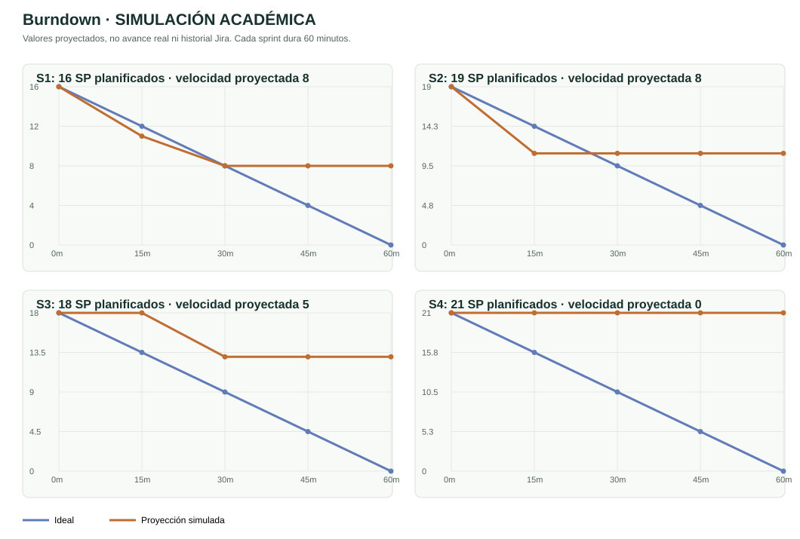
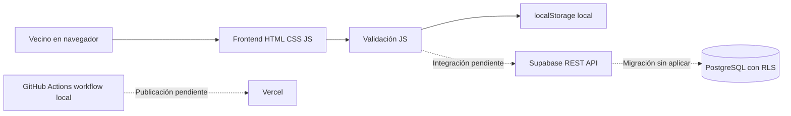

# Informe — Mascotas y salubridad en Lima Norte

**Examen:** cuatro horas, H0–H4, con cuatro sprints de **60 minutos**. El [backlog canónico](backlog.md) registra 74 SP planificados; los SP no son horas ni historias implementadas. La [rúbrica literal](entrega.md) se conserva aparte. Se consultó [SCRUM](https://anelis-pfc3.atlassian.net/jira/software/projects/SCRUM) en modo lectura: claves SCRUM-5 a SCRUM-24, padres, puntos y sprints. No se modificó Jira. No se ha comprobado acceso del docente.

## 1. Product Backlog y épicas

| Épica real | Nombre | Historias reales | SP planificados |
|---|---|---|---:|
| [SCRUM-5](https://anelis-pfc3.atlassian.net/browse/SCRUM-5) | Registro de propietarios y mascotas | SCRUM-9 a SCRUM-12 | 16 |
| [SCRUM-6](https://anelis-pfc3.atlassian.net/browse/SCRUM-6) | Reportes ciudadanos de incidencias | SCRUM-13 a SCRUM-16 | 19 |
| [SCRUM-7](https://anelis-pfc3.atlassian.net/browse/SCRUM-7) | Gestión municipal y fiscalización | SCRUM-17 a SCRUM-20 | 18 |
| [SCRUM-8](https://anelis-pfc3.atlassian.net/browse/SCRUM-8) | Mapa y monitoreo de puntos críticos | SCRUM-21 a SCRUM-24 | 21 |

**Total: 74 SP de backlog planificado.** [backlog.md](backlog.md) fija nombres, puntos, MoSCoW, dependencias, criterios de aceptación y estado real de las 16 historias. Los códigos HU del Excel son solo referencia de origen. La lectura JQL confirmó relaciones padre, estimaciones y sprint; no equivale a capturas ni acredita acceso del docente.

## 2. Cuatro sprints de 60 minutos — SIMULACIÓN ACADÉMICA

Los sprints de SCRUM consultados están en estado **future** y sus objetivos indican H0–H1, H1–H2, H2–H3 y H3–H4. La tabla siguiente conserva los SP asignados. **Solo las series de burndown y las velocidades son proyecciones simuladas**; ninguna representa ejecución real ni historias aceptadas.

| Sprint | Bloque | Objetivo resumido | Historias | SP planificados | Velocidad proyectada (SIMULACIÓN) |
|---|---|---|---|---:|---:|
| S1 Registro y mascotas | H0–H1 | Estructura de acceso y registro mínimo | SCRUM-9 a SCRUM-12 | 16 | 8 |
| S2 Reportes ciudadanos | H1–H2 | Registrar y consultar una incidencia | SCRUM-13 a SCRUM-16 | 19 | 8 |
| S3 Gestión municipal | H2–H3 | Persistencia, permisos y alcance real de gestión | SCRUM-17 a SCRUM-20 | 18 | 5 |
| S4 Mapa e indicadores | H3–H4 | Integrar, probar, revisar pipeline y entrega | SCRUM-21 a SCRUM-24 | 21 | 0 |

### Gantt relativo del tiempo de examen

Cada barra de 15 minutos es una **ventana de planificación**, no una afirmación de implementación o cierre. S1 cubre SCRUM-9 a SCRUM-12 entre H0 y H1; S2, SCRUM-13 a SCRUM-16 entre H1 y H2; S3, SCRUM-17 a SCRUM-20 entre H2 y H3; S4, SCRUM-21 a SCRUM-24 entre H3 y H4. El solapamiento es cero. Las dependencias del [backlog](backlog.md) fijan el orden lógico; varias historias quedan pendientes aun cuando su ventana de revisión haya pasado. Hitos: H1 revisar registro, H2 demostrar reporte, H3 verificar persistencia y permisos, H4 entregar evidencia.

### Burndown y velocidad proyectados — SIMULACIÓN ACADÉMICA

| Sprint | Minutos del bloque | Ideal SP pendientes | Proyección simulada SP pendientes | Velocidad proyectada |
|---|---|---|---|---:|
| S1 | 0, 15, 30, 45, 60 | 16, 12, 8, 4, 0 | 16, 11, 8, 8, 8 | 8 |
| S2 | 0, 15, 30, 45, 60 | 19, 14.25, 9.5, 4.75, 0 | 19, 11, 11, 11, 11 | 8 |
| S3 | 0, 15, 30, 45, 60 | 18, 13.5, 9, 4.5, 0 | 18, 18, 13, 13, 13 | 5 |
| S4 | 0, 15, 30, 45, 60 | 21, 15.75, 10.5, 5.25, 0 | 21, 21, 21, 21, 21 | 0 |

La proyección supone cierres hipotéticos de SCRUM-9 y SCRUM-10 en S1, SCRUM-13 en S2, SCRUM-18 en S3 y ninguno en S4; respeta la cadena de dependencias. **No se afirma que hayan ocurrido.** Los pendientes proyectados al cierre de cada bloque vuelven al backlog y no se contabilizan como velocidad. La aplicación actual no cumple todavía los criterios completos de SCRUM-13 ni SCRUM-18.

### Flujo Kanban

Secuencia obligatoria: **To Do → In Progress → In Review → Done**. Límites WIP: **3** y **2** para las columnas intermedias. El Gantt planifica como máximo una historia por ventana, de modo que la simulación de flujo puede mantener WIP 1/3 y 1/2 sin saltos. Los estados reales de Jira permanecen separados de estas proyecciones; no se movió ninguna incidencia durante esta actualización. Definition of Done real: aceptación Dado/Cuando/Entonces, pruebas, revisión de permisos y evidencia funcional.

## 3. Arquitectura lógica y DevSecOps

### Componentes efectivos y propuestos

La ruta efectiva de la demo es navegador → validación → `localStorage`; no hay backend propio ni autenticación. El código incluye una ruta REST de Supabase condicionada a URL y clave publicable, y una migración de `critical_reports` con PK UUID, restricciones, índice y RLS de lectura/inserción anónima. Su aplicación y permisos **no se han verificado**. `npm run verify:remote` llegó al proyecto con la configuración pública local, pero el POST obtuvo **HTTP 404 `PGRST205`**: `public.critical_reports` no existe en el esquema. No se insertó ningún dato y no hubo prueba RLS. El paso pendiente es aplicar [la migración](../supabase/migrations/202611190001_critical_reports.sql) en el SQL Editor del proyecto y repetir el script, que luego intenta leer, actualizar y borrar con acceso anónimo. No existe aún modelo propietario–mascota ni FK; PostgreSQL se justifica para relaciones y consultas futuras, pero la demo actual solo tiene una entidad de reporte. No se solicitan nombres de personas ni coordenadas precisas. La aplicación carece de moderación y límites de tasa para inserción pública.

La arquitectura DOCX adjunta propone Next.js, React, TypeScript, API Routes, Supabase Auth/Storage, Leaflet y OpenStreetMap. Esos componentes **no están en el código actual**. Cuenta, roles municipales, fotos y mapa son trabajo futuro. El diagrama físico previsto sería navegador → Vercel CDN y navegador → Supabase API → PostgreSQL, una vez configurados y verificados.

| Fase | Herramienta / actividad | Control | Estado y evidencia |
|---|---|---|---|
| Plan | Backlog y Jira SCRUM | Criterios y dependencias | 20 incidencias comprobadas en lectura; sin cambios en Jira |
| Code | Git, rama local de trabajo | Revisión antes de main | Rama `test/mascotas-salubridad`; cambios sin commit ni PR |
| Build | Node, `npm ci`, build estático | Lockfile y sintaxis | Correcto localmente y en [Actions 44665813492](https://github.com/ann0912/pfc3-examen/actions/runs/44665813492) |
| Test | `node --test` | Validación, escape de texto y persistencia local | 5 pruebas locales y job remoto correctos; no cubren criterios completos de SCRUM-13 |
| Release | PR de GitHub | Revisión y checks | Propuesta; sin PR ni branch protection verificados |
| Deploy | Workflow y Vercel | Job dependiente de seguridad | Omitido correctamente en el push de la rama de trabajo; no hay deploy comprobado |
| Operate | Supabase previsto | RLS y permisos mínimos | SQL escrito; sin aplicación ni prueba de identidades |
| Monitor | Logs de Actions/Vercel/Supabase | Diagnóstico de fallos | Propuesta futura |

**Seguridad implementada en el repositorio:** validación de distrito, categoría y longitud; escape de texto antes de insertarlo en HTML; migración con RLS escrita; workflow con pasos de patrones, audit, Gitleaks y CodeQL. **Verificado:** 5/5 pruebas locales, lint, build y audit locales; en [Actions 44665813492](https://github.com/ann0912/pfc3-examen/actions/runs/44665813492) pasaron build, test y security, incluidos Gitleaks y CodeQL. **Pendiente:** comprobar RLS real, bloquear merge con checks y asegurar que Vercel no publique producción por otra vía.

## 4. GitHub, pipeline y web

Repositorio: [ann0912/pfc3-examen](https://github.com/ann0912/pfc3-examen). El commit [`02e3b57`](https://github.com/ann0912/pfc3-examen/commit/02e3b57) está publicado en `test/mascotas-salubridad`; no hay PR verificado. El workflow conserva `git diff --check` y ordena los jobs **build → test → security → deploy**. La [ejecución 44665813492](https://github.com/ann0912/pfc3-examen/actions/runs/44665813492) pasó build, test y security; deploy se omitió porque fue un push a la rama de trabajo. El build produce una demo local sin configuración Supabase. No hay URL pública Vercel ni prueba de persistencia remota; tampoco se ha comprobado la configuración de producción de Vercel.

| Recorrido | Estado comprobable |
|---|---|
| Crear reporte anónimo con distrito, categoría, referencia y descripción | Código y pruebas unitarias locales; falta prueba visual de extremo a extremo |
| Persistir y consultar en el mismo navegador | Prueba automatizada con almacenamiento local |
| Filtrar por distrito y ver estado | Código local; falta prueba visual |
| Cuenta y registro de mascotas | No implementados |
| Mapa geográfico e indicadores | No implementados |
| Fiscalización y cierre municipal | No implementados |
| Supabase y Vercel | Integraciones preparadas parcialmente; sin verificación real |
| GitHub Actions | Build, test y security correctos en run 44665813492; deploy omitido |

Para la entrega faltan capturas reales del proyecto SCRUM y de Actions, comprobar acceso del docente, PR, despliegue y ZIP. El enlace a Actions sí demuestra los jobs remotos; no se adjudica evidencia de ejecución a la simulación académica.

## Guion breve y preguntas de práctica

1. **Backlog:** “Preparé cuatro épicas y 16 historias con 74 SP y dependencias. Las claves SCRUM-9 a SCRUM-24 se comprobaron por lectura.”
2. **Sprints:** “Proyecté burndown y velocidad para cuatro sprints de 60 minutos. Gantt, burndown y flujo Kanban usan los mismos IDs y puntos; no son resultados reales.”
3. **Arquitectura:** “La web actual registra reportes en el navegador; autenticación, mapa y fiscalización son funciones futuras. Supabase requiere prueba real.”
4. **Pipeline:** “El YAML encadena controles antes del deploy; solo afirmaría éxito cuando vea una ejecución de Actions y la URL pública.”

Preguntas: ¿Por qué SCRUM-13 está parcial aunque existe un formulario? ¿Qué dependencia habilita SCRUM-19? ¿Por qué un Done simulado no demuestra una historia aceptada? ¿Cuál es el WIP máximo y qué barra del Gantt muestra el mayor solapamiento? ¿Qué control impide deploy tras un fallo del job security? ¿Qué falta para afirmar que RLS protege datos reales?
