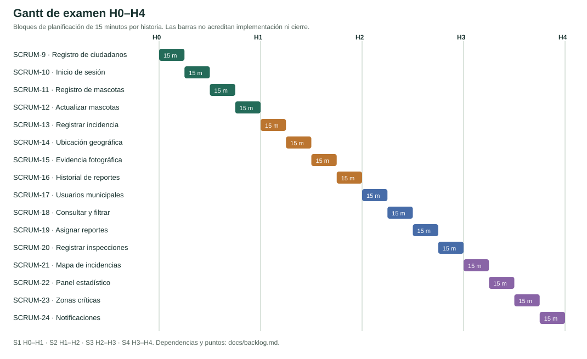
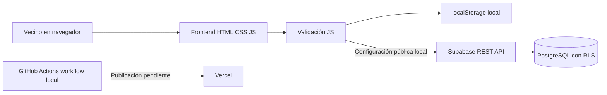
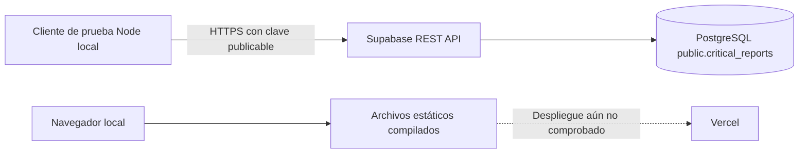

# Actualización de entrega — 20 de noviembre de 2026

**Corrección posterior al envío del ZIP inicial.** La creación de usuarios desde el panel Supabase falló porque el disparador de `profiles` exigía metadatos que ese formulario no solicita. Se aplicó la migración `202611200003_admin_created_profiles.sql` en el proyecto `pqgfhgpeilncwyoyymgq` (SQL Editor: «Success. No rows returned»). Permite teléfono y distrito vacíos y registra el nombre neutro «Usuario» cuando no se aporta uno; no inventa datos de contacto. Después, el panel mostró «Successfully created user» y la cuenta apareció en Auth. Se corrigió el uso de `event.currentTarget` tras `await` en los formularios y la inserción del código de reporte. El usuario confirmó en la web local una sesión iniciada y la persistencia de una mascota y un reporte ficticios tras recargar; esa comprobación fue realizada por el usuario, no observada por Codex tras interrumpirse el control del navegador. Sigue pendiente probar RLS con otra identidad y el flujo municipal. El ZIP se regeneró y verificó con estos cambios.

Esta actualización conserva el incremento de `feat/pc2-complete-system`, publicado en el commit `f2138ae` y el PR [#5](https://github.com/ann0912/pfc3-examen/pull/5), aún en borrador. El código añade interfaz de cuenta y mascotas, mapa, fotografías, filtros, indicadores y operaciones municipales. Las migraciones `202611200001` y `202611200002` modelan Auth, roles, RLS, asignaciones, inspecciones, historial y almacenamiento privado. **Estas funciones nuevas todavía no se acreditan como operativas en producción:** falta probar sesión autenticada, RLS por identidad y despliegue de este commit.

En este corte se ejecutaron `npm.cmd test` (**11/11 aprobadas**), `npm.cmd run build` (**aprobado**), `npm.cmd run lint` (**aprobado**), `npm.cmd run typecheck` (**aprobado; comprobación sintáctica, no TypeScript**) y `npm.cmd run security` (**sin hallazgos**). El PR #5 aprobó build, test, security y CodeQL en [Actions 44683249323](https://github.com/ann0912/pfc3-examen/actions/runs/44683249323); deploy se omitió por ser una rama. Las pruebas locales no sustituyen autenticación, RLS por rol, fotos o recorrido completo en producción. La evidencia de Chrome y Vercel de la sección siguiente corresponde a la versión anterior publicada.

Se revisaron y aplicaron en orden las migraciones nuevas mediante la sesión SQL Editor del proyecto Supabase `pqgfhgpeilncwyoyymgq`, coincidente con la configuración local. Ambas consultas devolvieron «Success. No rows returned». La API remota respondió HTTP 401 sin sesión para `critical_reports`, `profiles` y `pets`, frente a HTTP 404 previo para las dos tablas nuevas. Auth respondió HTTP 200 a un alta de prueba, pero sin sesión en esa respuesta; una repetición recibió HTTP 429 por límite de correo. **No se verificaron aún acceso autenticado, RLS por rol ni persistencia desde la nueva web.** No se declara historia adicional en Done ni velocidad real positiva.

El archivo `output/pfc3-examen-PC2.zip` se genera desde una lista explícita de código, migraciones, pruebas y documentación, excluyendo `.env.local`, `.tmp`, `node_modules`, `dist` y credenciales. Su apertura y contenido se verifican por lectura de entradas ZIP. Para la sustentación, distinguir la versión pública anterior de la ampliación local y mostrar primero el recorrido de reporte que sí fue comprobado.

# Corte de ejecución real — 19 de noviembre de 2026

La entrega pública verificada es [Lima Norte Saludable](https://pfc3-examen.vercel.app/). El despliegue [Vercel BopyiFAHN1Sao49pPWwK4CFKBoxP](https://vercel.com/usil2/pfc3-examen/BopyiFAHN1Sao49pPWwK4CFKBoxP) quedó **Ready**. Se usó la sesión local autenticada y el build de producción del mismo árbol de código de `main`; no se usó un deploy automático exitoso.

**Prueba real de navegador:** Chrome escritorio 1280 × 800 y móvil 390 × 844. La página respondió HTTP 200; el formulario validó campos vacíos, registró un reporte ficticio en modo Supabase, lo mostró en la lista, volvió a mostrarlo tras recargar y lo encontró con el filtro Los Olivos. En móvil no hubo desbordamiento horizontal. [Captura escritorio](evidencias/produccion-escritorio.png) y [captura móvil](evidencias/produccion-movil.png). El identificador de prueba visible fue «Parque público prueba PC2 e0e16277»; se trata de datos ficticios. La prueba directa adicional verificó POST/GET y rechazo PATCH/DELETE anónimos HTTP 401.

**GitHub y controles:** [PR #1](https://github.com/ann0912/pfc3-examen/pull/1), [PR #2](https://github.com/ann0912/pfc3-examen/pull/2) y [PR #3](https://github.com/ann0912/pfc3-examen/pull/3) están fusionados. En [Actions 44675027116](https://github.com/ann0912/pfc3-examen/actions/runs/44675027116), build, test y security aprobaron, pero deploy falló con `User not found (404)` en Vercel CLI. Posteriormente, [Actions 44677187328](https://github.com/ann0912/pfc3-examen/actions/runs/44677187328), del merge de PR #3 en `main`, aprobó **build, test, security y deploy**. La URL pública se revalidó con HTTP 200 y consulta REST 200 tras ese deploy. La publicación manual inicial también quedó documentada por separado. `vercel.json` desactiva el deploy automático por integración Git; el despliegue aprobado se hizo mediante Actions.

**Scrum real al corte:** cuatro bloques planificados de 60 minutos H0–H4; 74 SP estimados, 0 SP aceptados y 74 SP pendientes. SCRUM-13 está En curso: funcionan formulario, validación, inserción, consulta y filtro, pero faltan autenticación, código único visible y estado inicial «Recibido». SCRUM-18 tiene solo filtro público, sin panel municipal. Las otras 14 historias siguen pendientes. No se declara velocidad positiva. El [burndown actualizado](burndown-horas.svg) muestra los puntos pendientes reales, sin quemado inventado. El [Gantt](gantt-horas.svg) conserva ventanas **planificadas** y no acredita inicio o cierre de historias. Flujo previsto: To Do → In Progress → In Review → Done; WIP 3 y 2 en columnas intermedias. Los estados exactos del tablero deben consultarse en [Jira SCRUM](https://anelis-pfc3.atlassian.net/jira/software/projects/SCRUM); se añadió nueva evidencia técnica al [SCRUM-13](https://anelis-pfc3.atlassian.net/browse/SCRUM-13), sin moverlo a Done. No se ha comprobado el permiso de acceso del docente.

**Arquitectura efectiva:** navegador → frontend estático Vercel → Supabase REST API → PostgreSQL `public.critical_reports` con RLS. No hay backend propio, Supabase Auth, roles municipales, mapa ni registro de mascotas. El modo local es solo respaldo cuando no hay configuración; en producción se comprobó visualmente «Datos compartidos en Supabase» y persistencia tras recarga. La seguridad verificada incluye validación y escape de HTML, RLS de lectura/inserción anónima y rechazo de modificación/borrado anónimos. Moderación, límites de tasa, identidades y autorizaciones por rol quedan pendientes.

---

## Plan y cortes anteriores conservados como antecedente

Las secciones siguientes registran la planificación y observaciones previas al despliegue. Sus expresiones de «pendiente de URL», «PR en borrador» y burndown simulado **han sido sustituidas por el corte real anterior**; se conservan para mostrar la evolución documental y no describen el estado final.

# Informe — Mascotas y salubridad en Lima Norte

**Examen:** cuatro horas, H0–H4, con cuatro sprints de **60 minutos**. El [backlog canónico](backlog.md) registra 74 SP planificados; los SP no son horas ni historias implementadas. La [rúbrica literal](entrega.md) se conserva aparte. Se consultó [SCRUM](https://anelis-pfc3.atlassian.net/jira/software/projects/SCRUM) en modo lectura: claves SCRUM-5 a SCRUM-24, padres, puntos y sprints. No se modificó Jira. No se ha comprobado acceso del docente.

## 1. Product Backlog y épicas

| Épica real | Nombre | Historias reales | SP planificados |
|---|---|---|---:|
| [SCRUM-5](https://anelis-pfc3.atlassian.net/browse/SCRUM-5) | Registro de propietarios y mascotas | SCRUM-9 a SCRUM-12 | 16 |
| [SCRUM-6](https://anelis-pfc3.atlassian.net/browse/SCRUM-6) | Reportes ciudadanos de incidencias | SCRUM-13 a SCRUM-16 | 19 |
| [SCRUM-7](https://anelis-pfc3.atlassian.net/browse/SCRUM-7) | Gestión municipal y fiscalización | SCRUM-17 a SCRUM-20 | 18 |
| [SCRUM-8](https://anelis-pfc3.atlassian.net/browse/SCRUM-8) | Mapa y monitoreo de puntos críticos | SCRUM-21 a SCRUM-24 | 21 |

**Total: 74 SP de backlog planificado.** [backlog.md](backlog.md) fija nombres, puntos, MoSCoW, dependencias, criterios de aceptación y estado real de las 16 historias. Los códigos HU del Excel son solo referencia de origen. La lectura JQL confirmó relaciones padre, estimaciones y sprint; no equivale a capturas ni acredita acceso del docente.

## 2. Cuatro sprints de 60 minutos — SIMULACIÓN ACADÉMICA

Los sprints de SCRUM consultados están en estado **future** y sus objetivos indican H0–H1, H1–H2, H2–H3 y H3–H4. La tabla siguiente conserva los SP asignados. **Solo las series de burndown y las velocidades son proyecciones simuladas**; ninguna representa ejecución real ni historias aceptadas.

| Sprint | Bloque | Objetivo resumido | Historias | SP planificados | Velocidad proyectada (SIMULACIÓN) |
|---|---|---|---|---:|---:|
| S1 Registro y mascotas | H0–H1 | Estructura de acceso y registro mínimo | SCRUM-9 a SCRUM-12 | 16 | 8 |
| S2 Reportes ciudadanos | H1–H2 | Registrar y consultar una incidencia | SCRUM-13 a SCRUM-16 | 19 | 8 |
| S3 Gestión municipal | H2–H3 | Persistencia, permisos y alcance real de gestión | SCRUM-17 a SCRUM-20 | 18 | 5 |
| S4 Mapa e indicadores | H3–H4 | Integrar, probar, revisar pipeline y entrega | SCRUM-21 a SCRUM-24 | 21 | 0 |

### Gantt relativo del tiempo de examen

Cada barra de 15 minutos es una **ventana de planificación**, no una afirmación de implementación o cierre. S1 cubre SCRUM-9 a SCRUM-12 entre H0 y H1; S2, SCRUM-13 a SCRUM-16 entre H1 y H2; S3, SCRUM-17 a SCRUM-20 entre H2 y H3; S4, SCRUM-21 a SCRUM-24 entre H3 y H4. El solapamiento es cero. Las dependencias del [backlog](backlog.md) fijan el orden lógico; varias historias quedan pendientes aun cuando su ventana de revisión haya pasado. Hitos: H1 revisar registro, H2 demostrar reporte, H3 verificar persistencia y permisos, H4 entregar evidencia.

### Burndown y velocidad proyectados — SIMULACIÓN ACADÉMICA

| Sprint | Minutos del bloque | Ideal SP pendientes | Proyección simulada SP pendientes | Velocidad proyectada |
|---|---|---|---|---:|
| S1 | 0, 15, 30, 45, 60 | 16, 12, 8, 4, 0 | 16, 11, 8, 8, 8 | 8 |
| S2 | 0, 15, 30, 45, 60 | 19, 14.25, 9.5, 4.75, 0 | 19, 11, 11, 11, 11 | 8 |
| S3 | 0, 15, 30, 45, 60 | 18, 13.5, 9, 4.5, 0 | 18, 18, 13, 13, 13 | 5 |
| S4 | 0, 15, 30, 45, 60 | 21, 15.75, 10.5, 5.25, 0 | 21, 21, 21, 21, 21 | 0 |

La proyección supone cierres hipotéticos de SCRUM-9 y SCRUM-10 en S1, SCRUM-13 en S2, SCRUM-18 en S3 y ninguno en S4; respeta la cadena de dependencias. **No se afirma que hayan ocurrido.** Los pendientes proyectados al cierre de cada bloque vuelven al backlog y no se contabilizan como velocidad. La aplicación actual no cumple todavía los criterios completos de SCRUM-13 ni SCRUM-18.

**Burndown real al corte:** 0 historias aceptadas como Done, 0 SP de velocidad real y 74 SP pendientes del backlog. Esta cifra no sustituye las cuatro curvas de la simulación académica.

### Flujo Kanban

Secuencia obligatoria: **To Do → In Progress → In Review → Done**. Límites WIP: **3** y **2** para las columnas intermedias. El Gantt planifica como máximo una historia por ventana, de modo que la simulación de flujo puede mantener WIP 1/3 y 1/2 sin saltos. Los estados reales de Jira permanecen separados de estas proyecciones; no se movió ninguna incidencia durante esta actualización. Definition of Done real: aceptación Dado/Cuando/Entonces, pruebas, revisión de permisos y evidencia funcional.

## 3. Arquitectura lógica y DevSecOps

### Componentes efectivos y propuestos

La web usa `localStorage` sin configuración y Supabase REST con URL y clave publicable. No hay backend propio ni autenticación. El propietario aplicó [la migración](../supabase/migrations/202611190001_critical_reports.sql) de `critical_reports`, con PK UUID, restricciones, índice, RLS y privilegios anónimos de lectura e inserción. `npm.cmd run verify:remote` comprobó con datos ficticios POST 201, GET del mismo ID y rechazo de PATCH/DELETE anónimos con HTTP 401; el GET final conservó `Pendiente`. El reporte de prueba `cd161a4a-4ec7-4170-99f2-6abb18badbbb` permanece en la tabla. El rechazo se explica por los privilegios revocados con RLS habilitado; no demuestra una política municipal ni permisos de usuarios autenticados. Falta comprobar el flujo desde una web pública. No existe aún modelo propietario–mascota ni FK; PostgreSQL se justifica para relaciones y consultas futuras, pero la demo actual solo tiene una entidad de reporte. No se solicitan nombres de personas ni coordenadas precisas. La aplicación carece de moderación y límites de tasa para inserción pública.

La arquitectura DOCX adjunta propone Next.js, React, TypeScript, API Routes, Supabase Auth/Storage, Leaflet y OpenStreetMap. Esos componentes **no están en el código actual**. Cuenta, roles municipales, fotos y mapa son trabajo futuro. La topología física comprobada para la prueba remota es:

| Fase | Herramienta / actividad | Control | Estado y evidencia |
|---|---|---|---|
| Plan | Backlog y Jira SCRUM | Criterios y dependencias | 20 incidencias comprobadas en lectura; sin cambios en Jira |
| Code | Git, rama de trabajo | Revisión antes de main | PR [#1](https://github.com/ann0912/pfc3-examen/pull/1) en borrador, sin conflictos al consultar; no fusionado |
| Build | Node, `npm ci`, build estático | Lockfile y sintaxis | Correcto localmente y en [Actions 44665813492](https://github.com/ann0912/pfc3-examen/actions/runs/44665813492) |
| Test | `node --test` | Validación, escape de texto y persistencia local | 5 pruebas locales y job remoto correctos; no cubren criterios completos de SCRUM-13 |
| Release | PR de GitHub | Revisión y checks | PR [#1](https://github.com/ann0912/pfc3-examen/pull/1) sin conflictos; checks aprobados para `91ba5d0`; `main` sin protección de rama comprobada |
| Deploy | Workflow y Vercel | Job dependiente de seguridad | Omitido correctamente en el push de la rama de trabajo; no hay deploy comprobado |
| Operate | Supabase REST y PostgreSQL | RLS habilitado y privilegios mínimos anónimos | Migración aplicada; POST/GET correctos, PATCH/DELETE HTTP 401; sin prueba de identidad municipal |
| Monitor | Logs de Actions/Vercel/Supabase | Diagnóstico de fallos | Propuesta futura |

**Seguridad implementada en el repositorio:** validación de distrito, categoría y longitud; escape de texto antes de insertarlo en HTML; migración con RLS y privilegios anónimos mínimos; workflow con pasos de patrones, audit, Gitleaks y CodeQL. **Verificado:** 5/5 pruebas locales, lint, build y audit locales; en [Actions 44669124034](https://github.com/ann0912/pfc3-examen/actions/runs/44669124034) pasaron build, test y security, incluidos Gitleaks y CodeQL; la API real rechazó PATCH y DELETE anónimos. **Pendiente:** pruebas del navegador, política municipal, proteger `main` con checks y comprobar en Vercel que la integración Git no publique producción por otra vía. `vercel.json` desactiva despliegues automáticos por Git; esa configuración requiere verificación en el proyecto real.

## 4. GitHub, pipeline y web

Repositorio: [ann0912/pfc3-examen](https://github.com/ann0912/pfc3-examen). El commit [`91ba5d0`](https://github.com/ann0912/pfc3-examen/commit/91ba5d0) está publicado en `test/mascotas-salubridad`; el PR [#1](https://github.com/ann0912/pfc3-examen/pull/1) sigue en borrador. El workflow conserva `git diff --check` y ordena los jobs **build → test → security → deploy**. La [ejecución 44669124034](https://github.com/ann0912/pfc3-examen/actions/runs/44669124034) pasó build, test y security; deploy se omitió porque fue un push a la rama de trabajo. El build local genera configuración pública de Supabase, y la prueba directa de su API pasó. No hay URL pública Vercel ni prueba del recorrido desde esa URL; tampoco se ha comprobado la configuración de producción de Vercel.

| Recorrido | Estado comprobable |
|---|---|
| Crear reporte anónimo con distrito, categoría, referencia y descripción | Código y pruebas unitarias locales; falta prueba visual de extremo a extremo |
| Persistir y consultar en el mismo navegador | Prueba automatizada con almacenamiento local |
| Filtrar por distrito y ver estado | Código local; falta prueba visual |
| Cuenta y registro de mascotas | No implementados |
| Mapa geográfico e indicadores | No implementados |
| Fiscalización y cierre municipal | No implementados |
| Supabase | API real: POST/GET correctos; PATCH/DELETE anónimos HTTP 401; falta prueba desde la web pública |
| Vercel | Sin URL pública verificada |
| GitHub Actions | Build, test y security correctos en [run 44669124034](https://github.com/ann0912/pfc3-examen/actions/runs/44669124034); deploy omitido |

Para la entrega faltan capturas reales del proyecto SCRUM y de Actions, comprobar acceso del docente, despliegue y prueba web pública. El PR existe y el ZIP se genera desde el commit publicado, sin archivos ignorados. El enlace a Actions sí demuestra los jobs remotos; no se adjudica evidencia de ejecución a la simulación académica.

## Guion breve y preguntas de práctica

1. **Backlog:** “Preparé cuatro épicas y 16 historias con 74 SP y dependencias. Las claves SCRUM-9 a SCRUM-24 se comprobaron por lectura.”
2. **Sprints:** “Proyecté burndown y velocidad para cuatro sprints de 60 minutos. Gantt, burndown y flujo Kanban usan los mismos IDs y puntos; no son resultados reales.”
3. **Arquitectura:** “La API de Supabase guardó y leyó un reporte ficticio y rechazó cambios anónimos. Autenticación, mapa y fiscalización son funciones futuras.”
4. **Pipeline:** “El YAML encadena controles antes del deploy; solo afirmaría éxito cuando vea una ejecución de Actions y la URL pública.”

Preguntas: ¿Por qué SCRUM-13 está parcial aunque la API remota persiste reportes? ¿Qué dependencia habilita SCRUM-19? ¿Por qué un Done simulado no demuestra una historia aceptada? ¿Cuál es el WIP máximo y qué barra del Gantt muestra el mayor solapamiento? ¿Qué control impide deploy tras un fallo del job security? ¿Por qué HTTP 401 de PATCH/DELETE anónimos no demuestra permisos municipales?
